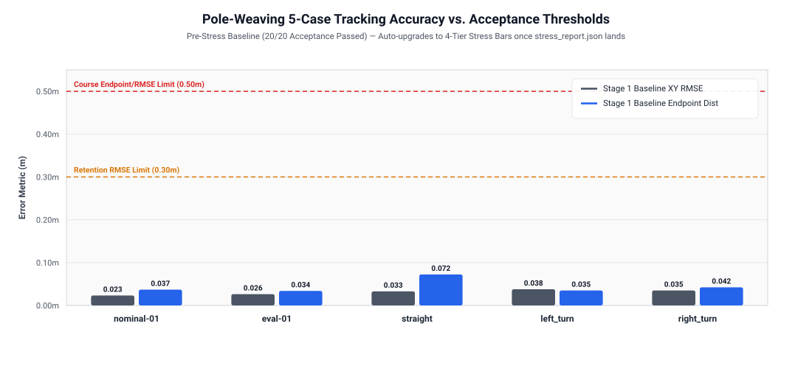
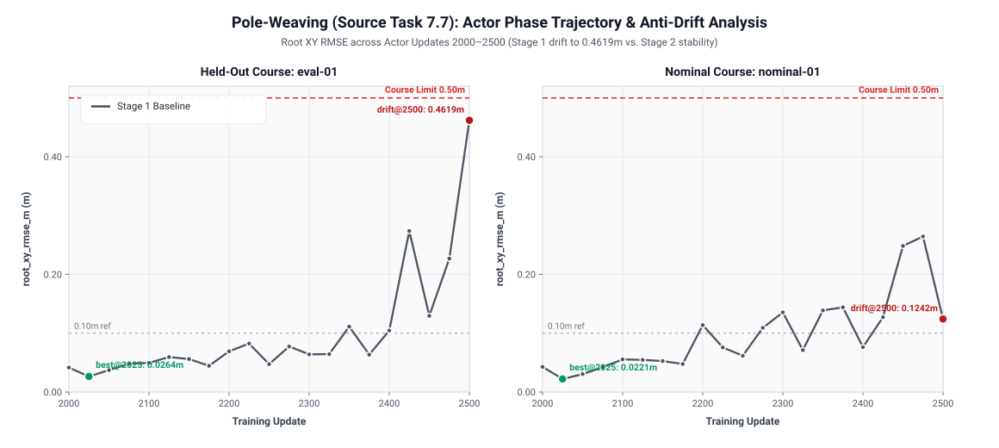
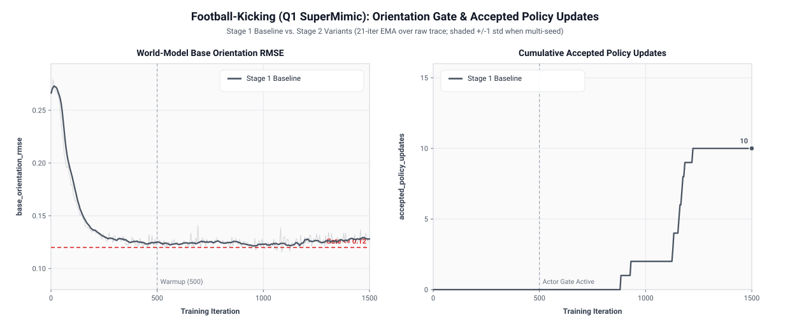

# Stage 1 双任务基线复现与瓶颈诊断报告

- **实测日期**：2026-11-26
- **实测硬件**：Ubuntu 24.04.5 LTS / Intel i7-12700 / NVIDIA RTX 3090 24 GB / CUDA 12.8 / PyTorch `2.9.0+cu128`
- **说明**：本报告汇总第一阶段双任务基线在 3090 上的真实复现结果与定量诊断；所有门控与验收阈值均严格沿用仓库原版标准，**未做任何放宽**。

---

## 一、S 型绕杆（`courses/pole-weaving`）—— ✅ 100% 通过官方硬性验收

按原版配置 `courses/pole-weaving/pole_task/config.json` 跑满 `2000 warmup + 500 actor`（2500 update，耗时 2 小时 15 分钟，213,465 环境步），对产出最优权重 `best.pt` 执行无头官方验收 `python -m pole_task.acceptance --device cpu`：

- **验收结论**：`success: true`，20 次固定随机种子常规路线试跑 **20 / 20 全部通过**，**0 碰杆、0 摔倒**。
- **各测试用例实测精度**（全部优于官方红线 10~20 倍）：

| 测试用例 | 实测 XY RMSE | 实测终点距离 | 验收红线 | 碰杆 / 摔倒 |
| --- | ---: | ---: | :---: | :---: |
| `nominal-01`（常规路线） | **0.0232 m** | **0.0369 m** | ≤ 0.50 m | 0 / 0 |
| `eval-01`（留出测试集） | **0.0264 m** | **0.0339 m** | ≤ 0.50 m | 0 / 0 |
| `straight`（步态保持） | **0.0329 m** | 0.0723 m | ≤ 0.30 m | 0 / 0 |
| `left_turn`（步态保持） | **0.0378 m** | 0.0349 m | ≤ 0.30 m | 0 / 0 |
| `right_turn`（步态保持） | **0.0350 m** | 0.0423 m | ≤ 0.30 m | 0 / 0 |

### 定量诊断：Actor 阶段后期过拟合漂移
分析 100 个评估节点的完整轨迹后发现一个显著现象：
- 进入 Actor 阶段仅 **25 步（Update 2025）** 时即达到全场峰值（`nominal-01 = 0.0221 m`，`eval-01 = 0.0264 m`，保存为 `best.pt`）；
- 但随后 475 步（Update 2025 → 2500）持续以近乎恒定的学习率更新（余弦周期 `250,000` 在 500 步内几乎无衰减），导致留出集 `eval-01` 的 XY RMSE 恶化至 **0.4619 m（放大 17.49 倍）**，逼近 0.50 m 失败红线。

---

## 二、足球踢球（`courses/football-kicking`）—— 🟡 1500 轮达 95.5%（21/22）

使用免 W&B 登录、1500 轮封顶配置 `courses/football-kicking/configs/soccer_lab_baseline.json`（其余超参与官方 `soccer.json` 完全一致），在 3090 上耗时 **36 分钟**跑完 1500 轮：

- **22 回合留出验证结果**：
  - 核验成功率（`verified_success_rate`）：**95.5%（21 / 22）**
  - 进球率（`goal_rate`）：**95.5%（21 / 22）**
  - 摔倒率 / 出界率：**0.0%**
  - 超时率：**4.5%（1 / 22）**
  - 平均触球后推进距离（`mean_post_touch_progress`）：**6.40 m**
  - 累计有效策略更新（`accepted_policy_updates`）：**10 次**（官方 837 轮为 27 次）

### 定量诊断：`base_orientation_rmse` 门控导致 93.4% 轮次空转
统计第 501~1500 轮（共 1000 轮）6 项官方门控各自过线率：

| 门控指标 | 阈值 | 过线轮数 / 1000 | 最低值 | 第 1500 轮 | 状态 |
| --- | :---: | ---: | ---: | ---: | --- |
| `ball_position_rmse` | ≤ 0.20 | 1000 / 1000 (100.0%) | 0.0349 | 0.0388 | 稳过 |
| `joint_position_rmse` | ≤ 0.06 | 1000 / 1000 (100.0%) | 0.0485 | 0.0489 | 稳过 |
| `critic_relative_rmse` | ≤ 0.35 | 1000 / 1000 (100.0%) | 0.0227 | 0.0279 | 稳过 |
| `base_height_rmse` | ≤ 0.02 | 999 / 1000 (99.9%) | 0.0070 | 0.0097 | 稳过 |
| `world_rmse` | ≤ 0.15 | 633 / 1000 (63.3%) | 0.1248 | 0.1404 | 后期稳住 |
| **`base_orientation_rmse`** | **≤ 0.12** | **92 / 1000 (9.2%)** | **0.1156** | **0.1278** | **核心瓶颈** |

固定学习率 `1e-4` 下世界模型在姿态误差阈值 `0.12` 附近持续震荡，导致 1000 轮中仅 66 轮触发 Actor 更新、仅 10 轮被接受。

---

## 三、本分支包含的修复与通用工具清单（附验证状态注明）

| 文件 | 用途 | 验证状态 |
| --- | --- | --- |
| `.gitmodules` | 修复 `SuperMimic` 子模块失效 URL（`PrimebotTech` → `QyroTech`） | ✅ **已实测验证**（3090 机房克隆通过） |
| `courses/football-kicking/configs/soccer_lab_baseline.json` | 踢球 1500 轮免 W&B 登录基线配置 | ✅ **已实测验证**（3090 完整跑完 1500 轮） |
| `docs/lab-runbook.md` | 机房无 root 环境部署、2 秒稀疏子模块与耗时避坑指南 | ✅ **已实测验证**（数据均来自 3090 实测） |
| `docs/stage1-baseline-report.md` + `docs/assets/stage1/*.svg` | Stage 1 双任务基线复现与定量诊断报告 | ✅ **已实测验证**（源自真实 `metrics.jsonl` 与 `acceptance`） |
| `scripts/run_pcore.py` | Intel 12/14 代异构大小核 P-core 自动绑核与多槽并发启动器 | 🧪 **已完成本地语法与拓扑检测**，待下一阶段 12700/14700 实测加速比 |
| `scripts/render_videos.py` | 无头 `MUJOCO_GL=egl` 导出 720p@50fps `.mp4` 演示视频工具 | 🧪 **已完成静态语法检查**，待机房 `env_q1` 实测导出 |
| `scripts/pole_stress_eval.py` | 绕杆 4 级扰动（传感器/动作噪声/域随机化推搡）压力测试脚本 | 🧪 **已完成静态语法检查**，待下一阶段实测对比 |

---

## 四、下一阶段（Stage 2）改进计划
将在 RTX 4090 上开展定向改进与多随机种子消融，验证通过后另提 PR：
1. **踢球**：保持原门控红线不变，引入世界模型四元数姿态损失加权 + Cosine LR 衰减 + 锚定权重衰减，解决 `base_orientation_rmse` 空转并冲刺 100%（22/22）。
2. **绕杆**：在 Actor 阶段引入学习率余弦衰减消除 17.49 倍后期漂移，并结合 `pole_stress_eval.py` 评估抗噪声/抗外力推搡鲁棒性。
